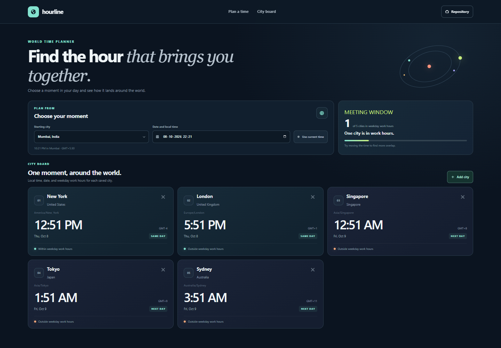

# Hourline - World Time Planner

Hourline helps compare a selected moment across cities. Choose a starting city and its local date and time, then see each saved city's clock, date, UTC offset, and weekday work-hour status.

**Live app:** [https://a2rp.github.io/world-time-planner/](https://a2rp.github.io/world-time-planner/)

## What's included

- A reference time selector with a starting city, local date and time, and a **Use current time** button. Use current time refreshes the reference moment as the clock moves.
- A meeting-window count showing how many saved cities fall within weekday work hours for the selected moment. Work hours are defined as Monday to Friday, 9:00 a.m. to 5:00 p.m. local time.
- A city board showing the converted time, timezone offset, local date, whether that date is the same day or crosses midnight, and whether the city is within weekday work hours.
- An **Add city** picker with search across the included city and timezone list. Close it by clicking outside or pressing Escape.
- A confirmation dialog when removing a city. Cancel or press Escape to keep that city.
- A responsive layout for desktop and mobile, with a dark mode visual design.

## Time conversion and saving

Conversions use the browser's built-in IANA timezone data through `Intl.DateTimeFormat`; the app makes no external time or geolocation API calls. It applies the timezone rules available in the current browser, including daylight-saving changes. A local time during a daylight-saving jump or repeated hour can be ambiguous, and the browser's timezone rules decide how that wall time is resolved.

The saved cities, starting timezone, and reference date and time are stored in this browser's local storage on this device. They are not uploaded or synced to an account. Clearing this site's browser data restores the default city board. Saved settings are checked when loaded, and the app warns if the browser cannot save an update. The picker includes a curated set of 16 cities; custom cities and user-defined timezone IDs are not supported yet.

The work-hour count is a simple weekday 9-to-5 check. It does not account for local holidays, individual schedules, or meeting duration.

## Run locally

Use Node.js and npm, then start the development server:

```sh
npm install
npm run dev
```

Run the linter and create a production build with:

```sh
npm run lint
npm run build
npm run preview
```

Publish the built `dist` folder to GitHub Pages with:

```sh
npm run deploy
```

The deploy script builds the app and publishes `dist` to the `gh-pages` branch, including the `.nojekyll` marker used by GitHub Pages.

## Future improvements

These are ideas and are not implemented:

- Search the complete IANA timezone catalog and let people save custom city names.
- Set custom workdays and working-hour ranges for each city.
- Account for regional public holidays and meeting duration.
- Find a shared time window across a selected range of dates.
- Export and import saved city boards.

## Links

- Portfolio: [https://www.ashishranjan.net](https://www.ashishranjan.net)
- GitHub: [https://github.com/a2rp](https://github.com/a2rp)
- CodePen: [https://codepen.io/ash1198](https://codepen.io/ash1198)
- LinkedIn: [https://www.linkedin.com/in/aashishranjan](https://www.linkedin.com/in/aashishranjan)
- Facebook: [https://www.facebook.com/theash.ashish/](https://www.facebook.com/theash.ashish/)
- YouTube: [https://www.youtube.com/@ashishranjan-ashz?sub_confirmation=1](https://www.youtube.com/@ashishranjan-ashz?sub_confirmation=1)
- Email: [mailto:ash.ranjan09@gmail.com](mailto:ash.ranjan09@gmail.com)

## Support

- Support: [https://a2rp-donation-page.netlify.app/](https://a2rp-donation-page.netlify.app/)
- Buy Me a Coffee: [https://buymeacoffee.com/ashishranjan](https://buymeacoffee.com/ashishranjan)
- Patreon: [https://www.patreon.com/ashishranjan](https://www.patreon.com/ashishranjan)
